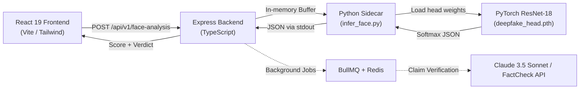

# TruthShield

TruthShield is a multimodal media verification engine and forensics dashboard. It combines a custom **PyTorch ResNet-18** deepfake face detector with LLM claim verification and perceptual media hashing to assess the authenticity of digital content.

[](LICENSE)
[](https://nodejs.org)
[](https://python.org)
[](https://pytorch.org)
[](https://www.typescriptlang.org)

---

## Features

- **Face Authenticity Scanner**: Custom transfer-learning PyTorch model trained on 140,000 real and AI-generated portraits (`xhlulu/140k-real-and-fake-faces`).
- **In-Memory Inference**: Uploaded images are buffered in RAM (`multer.memoryStorage`) and passed via base64 stream to a Python inference sidecar without persisting uploads to disk.
- **Claim & News Fact-Checking**: Corroborates textual claims against verified sources via Claude 3.5 Sonnet and the Google Fact Check API.
- **Perceptual Hashing (pHash)**: 64-bit visual hash comparison to detect duplicate or cropped brand assets.
- **Zero-Config Local Mode**: Runs without Postgres or Redis installed using in-memory emulation (`pg-mem`, mock queues).
- **Forensic Dashboard**: Dark-mode React 19 interface with real-time confidence scores and per-class probability bars.

---

## Deepfake Face Model (PyTorch ResNet-18)

The facial analysis pipeline uses transfer learning on an ImageNet-pretrained ResNet-18 backbone.

```
Input Image (RGB) 
  │
  ▼
Transforms: Resize(224, 224) ──▶ ToTensor() ──▶ ImageNet Normalization
  │
  ▼
Frozen ResNet-18 Backbone (Feature Extractor: 512-dim embedding)
  │
  ▼
Custom Linear Head: nn.Linear(512, 2)
  │
  ▼
Softmax Distribution ──▶ [P(fake), P(real)]
```

### Model Specifications

| Parameter | Value |
| :--- | :--- |
| **Backbone** | `torchvision.models.resnet18(weights='IMAGENET1K_V1')` (frozen) |
| **Classifier Head** | `nn.Linear(512, 2)` (trained on T4 GPU) |
| **Dataset** | Kaggle `140k-real-and-fake-faces` (70k real, 70k synthetic) |
| **Class Index** | `0: fake`, `1: real` |
| **Input Shape** | `(3, 224, 224)` normalized with ImageNet mean & std |
| **Validation Accuracy** | **79.29%** on hold-out validation split |
| **Weight File** | `api/models/deepfake_head.pth` (~4 KB, head state dict only) |

### Training Workflow (Google Colab T4 GPU)

The classification head was trained in Google Colab with the following steps:

```python
import torch
import torch.nn as nn
from torchvision import datasets, models, transforms
from torch.utils.data import DataLoader

# 1. Image preprocessing
transform = transforms.Compose([
    transforms.Resize((224, 224)),
    transforms.ToTensor(),
    transforms.Normalize(mean=[0.485, 0.456, 0.406], std=[0.229, 0.224, 0.225])
])

train_data = datasets.ImageFolder('faces_data/real_vs_fake/real-vs-fake/train', transform=transform)
val_data   = datasets.ImageFolder('faces_data/real_vs_fake/real-vs-fake/valid', transform=transform)

train_loader = DataLoader(train_data, batch_size=32, shuffle=True)
val_loader   = DataLoader(val_data, batch_size=32)

# 2. Frozen backbone + custom classification head
model = models.resnet18(weights='IMAGENET1K_V1')
for param in model.parameters():
    param.requires_grad = False
model.fc = nn.Linear(model.fc.in_features, 2)

device = torch.device('cuda' if torch.cuda.is_available() else 'cpu')
model = model.to(device)

# 3. Training head only
criterion = nn.CrossEntropyLoss()
optimizer = torch.optim.Adam(model.fc.parameters(), lr=0.001)

for epoch in range(5):
    model.train()
    running_loss = 0.0
    for images, labels in train_loader:
        images, labels = images.to(device), labels.to(device)
        optimizer.zero_grad()
        loss = criterion(model(images), labels)
        loss.backward()
        optimizer.step()
        running_loss += loss.item()
    print(f"Epoch {epoch+1}/5 - Loss: {running_loss/len(train_loader):.4f}")

# 4. Evaluation (Yields ~79.29% validation accuracy)
model.eval()
correct, total = 0, 0
with torch.no_grad():
    for images, labels in val_loader:
        images, labels = images.to(device), labels.to(device)
        preds = model(images).argmax(dim=1)
        correct += (preds == labels).sum().item()
        total += labels.size(0)

print(f"Validation Accuracy: {100 * correct / total:.2f}%")

# 5. Export FC head weights
torch.save(model.fc.state_dict(), 'deepfake_head.pth')
```

> **Evaluation Note**: ~79% validation accuracy reflects in-distribution performance on the 140k dataset. Studio portraits with heavy makeup, retouching, or flat lighting can occasionally trigger false positives. The UI labels every result as an experimental heuristic rather than a definitive verdict.

---

## Architecture



---

## Quickstart

### Prerequisites
- **Node.js**: v20+ and `npm`
- **Python**: 3.10+ with `pip`

### 1. Clone & Install Dependencies

```bash
git clone https://github.com/navyaaa27/truthshield-api.git
cd truthshield-api/truthshield-api-main
```

**Backend:**
```bash
cd api
npm install
pip install -r requirements.txt
cp .env.example .env
```

> Ensure the trained model checkpoint is located at: `api/models/deepfake_head.pth`.  
> *(On first inference, Torchvision downloads the standard ~44 MB ResNet-18 ImageNet backbone into local cache).*

**Frontend:**
```bash
cd ../frontend
npm install
```

### 2. Run the Stack

**Terminal 1 — API Server (`http://localhost:3000`):**
```bash
cd api
npm run dev
```

**Terminal 2 — Frontend UI (`http://localhost:5173`):**
```bash
cd frontend
npm run dev
```

1. Open `http://localhost:5173`.
2. Go to **Create account** to create a local developer session.
3. Click **Face Analysis** in the sidebar.
4. Upload any portrait image to test real-time classification.

---

## API Reference

### Face Analysis
`POST /api/v1/face-analysis`

Accepts a single portrait image (`multipart/form-data`) and processes it in memory.

**Request:**
```bash
curl -X POST http://localhost:3000/api/v1/face-analysis \
  -H "Authorization: Bearer <TOKEN>" \
  -F "image=@portrait.jpg"
```

**Response (`200 OK`):**
```json
{
  "success": true,
  "data": {
    "prediction": "real",
    "scores": {
      "fake": 0.0479,
      "real": 0.9521
    },
    "confidence": 0.9521,
    "disclaimer": "This is an experimental model estimate (≈79% validation accuracy on training dataset). It is not a definitive authenticity verdict and does not apply to videos."
  }
}
```

### Core API Endpoints

| Method | Endpoint | Description | Auth |
| :--- | :--- | :--- | :---: |
| `POST` | `/api/v1/auth/register` | Register user & organization | No |
| `POST` | `/api/v1/auth/login` | Authenticate & issue JWT | No |
| `POST` | `/api/v1/face-analysis` | PyTorch ResNet-18 face classification | Yes |
| `POST` | `/api/v1/jobs` | Submit claim or URL verification job | Yes |
| `GET`  | `/api/v1/jobs` | List recent verification scans | Yes |
| `GET`  | `/api/v1/alerts` | List critical detection alerts | Yes |
| `POST` | `/api/v1/reports` | Export PDF audit dossier | Yes |

---

## Repository Structure

```
truthshield-api/
├── api/
│   ├── models/                  # PyTorch model weights (deepfake_head.pth)
│   ├── scripts/
│   │   └── infer_face.py        # Python inference sidecar (stdin/stdout JSON)
│   ├── src/
│   │   ├── modules/
│   │   │   ├── auth/            # JWT authentication & session tokens
│   │   │   ├── face-analysis/   # Face analysis routes & Multer upload handling
│   │   │   ├── jobs/            # BullMQ background job definitions
│   │   │   └── reports/         # PDF audit dossier compiler
│   │   ├── shared/              # pg-mem mock database, Redis clients
│   │   └── app.ts               # Express application router
│   ├── requirements.txt         # Python dependencies (torch, torchvision, Pillow)
│   └── package.json
└── frontend/
    ├── src/
    │   ├── pages/
    │   │   ├── DashboardPage.tsx     # Main dashboard & forensics overview
    │   │   └── FaceAnalysisPage.tsx  # Drag-and-drop face analysis view
    │   ├── lib/api.ts                # Axios client with JWT interceptors
    │   └── App.tsx                   # Client router
    └── package.json
```

---

## Contributing

1. Fork the repo and create your branch: `git checkout -b feature/name`
2. Ensure linting passes: `npm run lint` and `npm test`
3. Commit using conventional commit format: `git commit -m 'feat: Add audio analysis'`
4. Push and open a Pull Request.

---

## License

[MIT](LICENSE) © TruthShield AI
